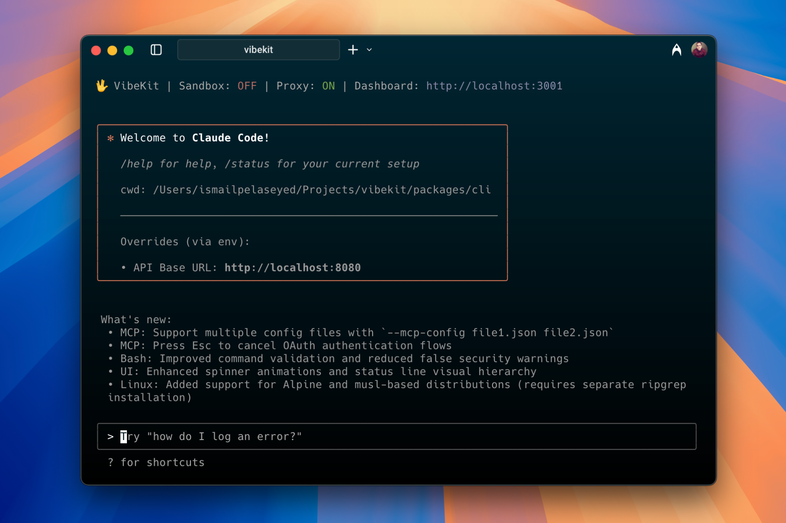

<div align="center">



# VibeKit is the safety layer for your coding agent 🖖

Run Claude Code, Gemini, Codex — or any coding agent — in a clean, isolated sandbox with sensitive data redaction and observability baked in.

---

[Website](https://vibekit.sh) • [Docs](https://docs.vibekit.sh) • [Discord](https://discord.com/invite/mhmJUTjW4b)

---
</div>

## 🚀 Quick Start

Install the VibeKit CLI globally:

```bash
npm install -g vibekit
```

Run claude code with enhanced security and tracking

```bash
vibekit claude
```

## ⚡️ Key Features

🐳 **Local sandbox** - Runs agent output in isolated Docker containers — zero risk to your local setup

🔒 **Built-in redaction** - Auto-removes secrets, api keys, and other sensitive data completions

📊 **Observability** - Complete visibility into agent operations with real-time logs, traces, and metrics

🌐 **Universal agent support** - Works with Claude Code, Gemini CLI, Grok CLI, Codex CLI, OpenCode, and more

💻 **Works offline & locally** - The middleware runs on your machine. Use `vibekit claude --no-search` to disable the default online search connection.

## 📦 Related Packages

Looking to integrate VibeKit into your application? Check out these packages:


### [📚 VibeKit SDK](https://github.com/superagent-ai/vibekit/tree/main/packages/sdk)
Run coding agents in secure sandboxes with full control and monitoring.

```bash
npm install @vibe-kit/sdk
```

Perfect for building applications that need to execute AI-generated code safely.

### [🔐 VibeKit Auth](https://github.com/superagent-ai/vibekit/tree/main/packages/auth) 
Use your MAX subscriptions in AI Apps.

```bash
npm install @vibe-kit/auth
```

Handle authentication flows for your VibeKit-powered applications.


## 🤝 Contributing

Contributions welcome! Open an issue, start a discussion, or submit a pull request.

## 📄 License

MIT — see [LICENSE](./LICENSE) for details.

© 2025 Superagent Technologies Inc.
